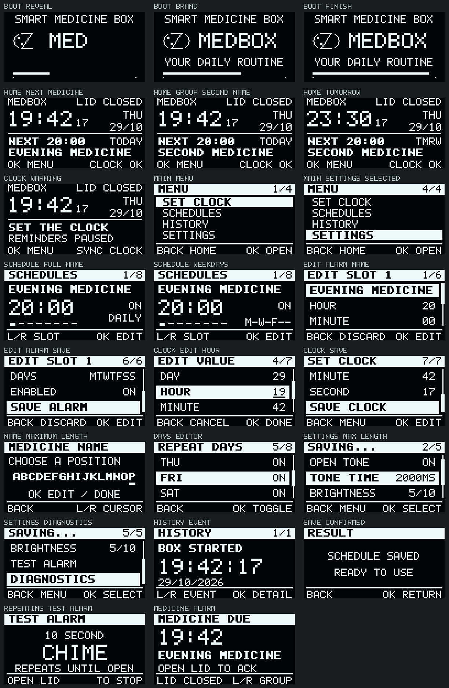

# Smart Medicine Box

[](https://github.com/Sreeram-R-6/smart-medicine-box/actions/workflows/ci.yml)

A working STM32 medicine-reminder prototype with an animated OLED interface and an ESP32-C3 local web dashboard. The STM32 runs the reminders independently; the ESP32 lets a phone view status and update the same saved configuration over UART.

**STM32:** `1.2.1-recovery` · **ESP32:** `1.1.0-activity` · **Build:** PlatformIO · **Cloud:** not required

**Current bench status:** after rewiring, RTC time and the UART link recovered, but OLED communication remains intermittent. See [recovery changes and unresolved hardware checks](docs/20-rewiring-recovery.md). Earlier screen images do not certify the rewired assembly.



*Selected screens from the firmware's 128×64 framebuffer fixtures. These are pixel renders, not photographs.*

## What it does

- Eight named reminders with independent times, weekday selection and enable/disable controls.
- A large clock, next-reminder time and full medicine name on Home. Medicines at the same time cycle through their names.
- A short, skippable boot animation and four-button menus for clock, schedules, history and settings.
- A ten-second alarm melody that repeats until a fresh lid opening. Hold **BACK + OK** for about one second to test it.
- RTC health checks that pause new reminders when time is invalid, stopped or untrusted.
- Persistent schedules, settings, reminder checkpoints and a 32-event history in alternating, CRC-checked flash banks.
- A phone dashboard with live status and confirmed web-to-STM32 saves, including stale-edit detection and UART retries.
- A measured reminder log, explicit taken/not-taken self-reports, response/ringing averages, opening counts between alarms, per-medicine totals and local CSV export. [Definitions and retention](docs/19-activity-dashboard.md).

Opening the lid records acknowledgment of a box opening; it does not confirm that medicine was taken. This is a student hardware prototype, not a certified medical device.

## Quick start

1. Check the [hardware and wiring guide](docs/hardware.md), especially module voltage levels and separate board power.
2. Install [PlatformIO](https://docs.platformio.org/en/latest/core/installation/index.html), connect ST-Link to the STM32, and connect the ESP32-C3 by a USB-C data cable.
3. Build both firmware targets:

   ```sh
   pio run -e stm32
   pio run -e esp32
   ```

4. Upload each target as described in [Build and flash](docs/getting-started.md).
5. Join **MedBox**, password **medbox-setup**, and open **http://192.168.4.1/**. Stay connected if the phone reports no internet. A captive-portal sign-in page is also supported.
6. Sync the clock, edit the reminder names/times, and test the lid alarm before using the box.

The default demonstration reminders are daily at **06:00, 10:00, 13:00, 16:00, 20:00 and 23:00**, India civil time. Slots 7 and 8 are disabled. These are editable examples, not prescribed medicine times.

## Hardware at a glance

| Component | Controller connection |
| --- | --- |
| LEFT / RIGHT / BACK / OK buttons | STM32 A0 / A1 / A4 / A5 to GND |
| 128×64 SSD1306-compatible I²C OLED | B6 SCL, B7 SDA |
| DS3231 RTC | B6 SCL, B7 SDA; backup battery |
| FC-51 lid sensor | B12 OUT, verified 3.3 V logic |
| Verified buzzer module | B0 I/O |
| ESP32-C3 SuperMini | STM32 A2 TX → GPIO4 RX; A3 RX ← GPIO5 TX; common GND |
| ST-Link | A13 SWDIO, A14 SWCLK, GND |

Power the STM32 and ESP32 through their own USB inputs. Do not power the ESP32 from the Blue Pill's unverified 3.3 V regulator or join regulator outputs. Buttons have no VCC connection. See [complete wiring](docs/hardware.md) before connecting modules.

## Verified status and known limitations

Both boards were flashed and checked on attached hardware. Web edits reached STM32 flash, survived a reset, and were read back; the original test configuration was restored. Wi-Fi and phone dashboard access were confirmed. The repeating alarm stayed active beyond 28 seconds and stopped on a physical lid opening. The OLED UI and navigation were confirmed on the device.

**An unresolved hardware issue remains on the tested assembly:** its RTC backup battery measured **1.8 V** and the clock lost time when power was removed. Replace that depleted battery, synchronize again, and repeat the power-off retention test. Main-power time synchronization passing does not certify battery backup.

No cloud backend, remote internet control or medicine-ingestion detection is implemented. Wi-Fi uses a documented bench password and plain local HTTP; read [local access and security](SECURITY.md) before changing its network exposure. Full evidence and limits: [validation](docs/validation.md).

## Documentation

| Guide | Contents |
| --- | --- |
| [Build and flash](docs/getting-started.md) | Tools, pinned targets, uploads and first boot |
| [Hardware](docs/hardware.md) | Parts, complete pin map, power, buttons, RTC and lid calibration |
| [Architecture](docs/architecture.md) | Main loop, storage, clock trust, alarms and source map |
| [Protocol and HTTP API](docs/protocol-and-api.md) | UART frame layout, telemetry, commands and confirmed saves |
| [OLED interface](docs/18-oled-ui.md) | Layouts, navigation, next-reminder calculation and previews |
| [Activity dashboard](docs/19-activity-dashboard.md) | Sensor vs self-report, timing, opening counts, averages and storage migration |
| [Validation and troubleshooting](docs/validation.md) | Reproducible tests, bench evidence and fault checks |
| [Documentation index](docs/README.md) | Current guides and historical bring-up notes |

## Development

Python 3.10+, a GCC-compatible host compiler, and Node.js 18+ are sufficient for the hardware-independent tests:

```sh
python tools/test_host.py
node tools/test_dashboard.mjs
python tools/check_project.py
python tools/render_oled_previews.py
```

`tools/test_host.py --cc /path/to/gcc` supports compilers outside PATH. See [tests](tests/README.md) and [contributing](CONTRIBUTING.md). GitHub Actions builds both firmware targets and runs the host suites; CI does not flash hardware.

Original application code has no project-wide license grant selected yet. Third-party files retain their own notices; see [THIRD_PARTY_NOTICES.md](THIRD_PARTY_NOTICES.md).
