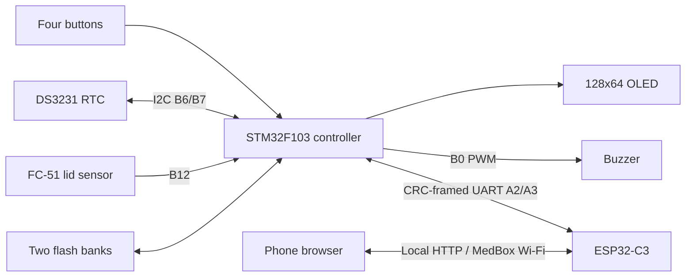

# Architecture

The STM32 owns reminder timing and persistent configuration. The ESP32 is an independent local user interface. Disconnecting Wi-Fi does not remove the STM32's local menu, schedules or lid sensing.

## STM32 execution

The controller uses STM32Cube HAL, an 8 MHz HSI clock and a cooperative main loop. There is no RTOS. UART interrupts move bytes through bounded buffers; the loop parses frames, debounces input, handles the OLED, samples the RTC, advances alarms and commits changed data.

OLED transfers are paced and update changed pages. The GPIO open-drain I²C transport has bounded clock-stretch waits and recovers by releasing the lines, sending up to nine clock pulses and a STOP. It does not use the F1 I²C peripheral. OLED initialization retries after failures; frame chunks restore their page/column before retransmission. Boot animation frames do not block scheduling or UART processing.

TIM3 channel 3 generates the buzzer carrier. The loop selects the melody note by elapsed monotonic time; flash erase is preceded by silence so a CPU stall does not stretch a driven note. An opening information tone is separate from the medicine alarm sound.

## Clock trust

The DS3231 calendar is range/BCD-checked. Oscillator-stop status, read failures, stalled seconds and unexpected jumps prevent trusted time. A set operation validates and writes the clock, verifies ticking, then clears OSF. Three subsequent advancing ticks are needed for normal trust.

Trusted time gates **new** reminder occurrences. Pending alarms can still be acknowledged when time is untrusted. The stored last-known epoch detects some backward resets; it is not a replacement for a functioning backup battery or an independent time source. The clock is not silently rewritten from a firmware build timestamp at boot.

The current product stores India civil time. The browser's sync operation converts its device time to India time; there is no configurable timezone or daylight-saving rule engine.

## Reminder semantics

There are eight slots, each with a 16-character name, hour, minute, Monday-to-Sunday mask and enabled flag. Occurrences at the same timestamp form a group with a snapshot of the medicine names. A per-slot high-water timestamp suppresses duplicate occurrences.

After a clock gap or downtime, only the most recent matching occurrence per slot is considered. An occurrence within fifteen minutes can become active; older ones are recorded as downtime uncertainty. Once active, the ten-second melody repeats until a fresh closed-to-open lid transition. There is no current automatic expiry for an active reminder. A lid already open must close and open again. A fresh opening acknowledges all armed active groups.

The test alarm follows the same repeating sound/stop interaction without creating a medicine occurrence. It is temporary and is not restored across reboot. Opening is not proof of ingestion; no code should label it as a confirmed dose.

## Persistent storage

| Address range | Purpose |
| --- | --- |
| 0x08000000–0x0800DFFF | 56 KiB application |
| 0x0800E000–0x0800EFFF | 4 KiB storage bank 0 |
| 0x0800F000–0x0800FFFF | 4 KiB storage bank 1 |

Each bank has magic, schema, sequence, length, payload CRC32 and a commit marker. Saves erase the inactive bank, program/verify the payload and write the commit marker last. Startup selects the newest valid bank or falls back to the older valid bank. If both nonblank banks are corrupt, the firmware does not silently enable a fresh set of example alarms.

Payload schema 2 preserves the 2072-byte schema-1 prefix and appends persistent activity analytics: 24 medicine records, eight intervals and lifetime slot totals. Valid schema-1 banks are decoded without losing schedules/history/settings; old timing is not invented. See [activity tracking](19-activity-dashboard.md). Ordinary history writes are coalesced, so a sudden power cut can lose a newly added ordinary lid event. Confirmed schedule/report saves wait for a real flash commit. Further format changes require an explicit migration plan.

## ESP32 and consistency

The ESP32 serves a self-contained HTML page, local DNS/captive-portal responses and form-based HTTP endpoints. Telemetry is a mirror of STM32 state. Saves carry a configuration checksum, are retried under the same transaction ID, and require an STM32 result. The browser waits for acknowledgment and matching configuration readback before reporting success.

Conflicting local OLED drafts reject remote writes as busy. Retries use an in-memory last-result cache on STM32; the cache does not survive a controller reboot. A lost response can leave an unknown result, which must be reconciled from current state. A stale revision is rejected rather than treated as a confirmed mutation.

History and analytics are polled with generation tags. The receiver rejects mismatched generations while rings rotate and displays loading/stale states until a consistent pass completes. The legacy untagged history request remains supported for older clients.

## Source map

| Path | Role |
| --- | --- |
| `firmware/stm32/main.c` | HAL setup, cooperative services, input/UART integration |
| `menu.c`, `menu.h` | Hardware-independent button/menu state and drafts |
| `soft_i2c.c`, `soft_i2c.h` | Single-master GPIO bus, register transfers and bounded bus recovery |
| `screen.c`, `upcoming.c` | Pixel rendering, boot frames and next reminder |
| `calendar.c`, `rtc_health.c` | Calendar arithmetic and trust checks |
| `alarm.c` | Occurrence groups, deduplication, melody and acknowledgment |
| `analytics.c` | Persistent measurements, opening intervals and explicit user reports |
| `persistence.c`, `storage.c` | Validation/CRC format and HAL flash operations |
| `remote.c` | Wire configuration validation and telemetry packing |
| `firmware/esp32/main.cpp` | AP, HTTP, UART bridge and USB maintenance transport |
| `firmware/esp32/dashboard.html` | Editable page source |
| `shared/control.h` | Protocol v2 framing/parser |
| `tests/` | Host tests and fixtures |
